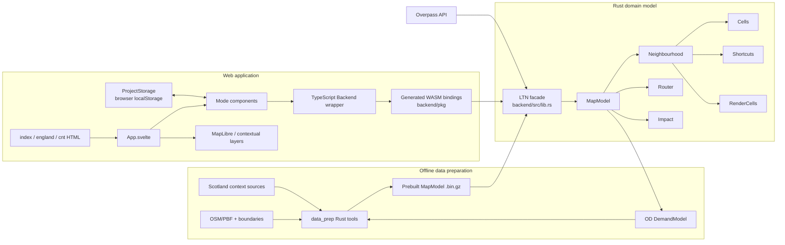
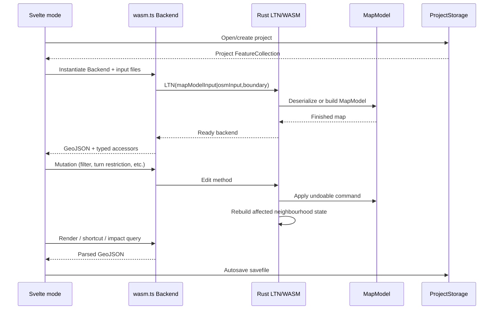
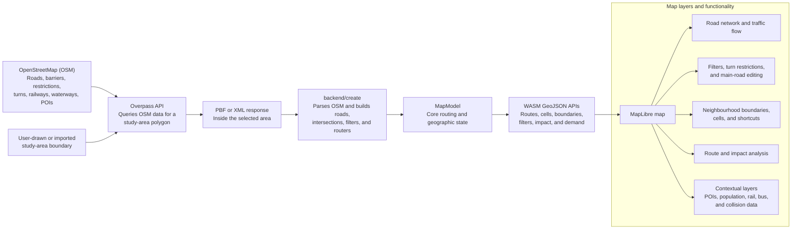

# Architecture map

## System overview

The application is a stateful single-page app. Svelte controls navigation and
map presentation; Rust/WASM owns the important geographic and transportation
state. Projects are serialized as GeoJSON plus project metadata and stored in
browser `localStorage`.

## Runtime flow

### Named configuration snapshots

The project's active editable state remains the current savefile feature
collection. Named configurations are stored as an optional
`saved_configurations` foreign member alongside it, with each entry containing
a name and a captured project savefile. Autosave must preserve this member when
it replaces the active feature collection. Older projects without the member
remain valid.

Restoring a configuration loads its captured features against the project's
current OSM-backed `MapModel`; it does not replace the original routing
baseline. Consequently, “Show before edits” continues to mean the original
OSM state. Snapshots are configuration data, not separate MapLibre rendering
layers. Stable geographic savefile features—not runtime road or intersection
IDs—identify edits across reloads.

## Entry points and UI

| Area | Main files | Responsibility |
|---|---|---|
| App shell | `web/src/App.svelte` | Initializes WASM and route-snapper, creates MapLibre, fixes map-layer z-order, and dispatches by `Mode`. |
| Global mode state | `web/src/stores.ts` | Svelte stores for the active mode, current project, backend, map, settings, route points, and metric buckets. |
| HTML variants | `web/index.html`, `england.html`, `cnt.html` | Host the same Svelte app with different `AppFocus` values: global import/custom area, England, or Scotland/CNT. |
| Project titles/loading | `web/src/title/`, `web/src/common/ProjectStorage.ts` | Project selection, creation, URL loading, localStorage persistence, schema migration, and asset/Overpass acquisition. |
| Project loading | `web/src/title/loader.ts` | Downloads a prebuilt `.bin.gz` for CNT/England or an OSM PBF/boundary for example/global areas, and loads savefiles. |
| Neighbourhood navigation | `web/src/pick_neighbourhood/PickNeighbourhoodMode.svelte` | Lists, creates, renames, and deletes neighbourhoods; selects editing or impact modes. |
| Boundary creation | `web/src/AddNeighbourhoodMode.svelte`, `web/src/SetBoundaryMode.svelte` | Choose generated boundaries, merge boundaries, or draw/edit a neighbourhood boundary. |
| Editing | `web/src/edit/NeighbourhoodMode.svelte` | The primary editing UI: filters, one-way roads, main roads, turn restrictions, undo/redo, shortcuts, and before/after display. |
| Routing | `web/src/RouteMode.svelte`, `web/src/AnimatePaths.svelte` | Compares before/after routes and visualizes route changes; route snapping comes from `route-snapper`. |
| Impact | `web/src/PredictImpactMode.svelte`, `web/src/ImpactDetailMode.svelte`, `web/src/ImpactOneDestinationMode.svelte` | Area-wide OD impact, impacted-road details, and impact radiating from one destination. |
| Debug tools | `web/src/Debug*.svelte` | Inspect intersections, neighbourhood geometry/cells, and demand data. |
| Map layers | `web/src/layers/`, `web/src/context/` | Convert backend GeoJSON to MapLibre layers and show POIs, population, rail, bus, collisions, and other context layers. |
| WASM bridge | `web/src/wasm.ts`, `backend/pkg/` | Thin typed TypeScript wrapper around generated bindings. The package is a build artifact; source APIs live in Rust. |
| Translations/assets | `web/src/locales/`, `web/assets/` | Localized UI strings and map/control icons/styles. |

### What is Overpass?

**Overpass** is the Overpass API, a public read-only API for querying
OpenStreetMap (OSM) data. In this app, when a user imports or draws a custom
study area, the frontend generates an Overpass query for that polygon, receives
the OSM data inside it, and passes the result to the Rust/WASM backend for map
construction.

Overpass is primarily used for custom/global areas. Prepackaged CNT, England,
and built-in example areas use downloaded PBF extracts or serialized
`MapModel` files instead.

## Road classification and extending it

The backend uses OSM's `highway=*` values, but applies a few different
classifications for different purposes:

| Purpose | Current behavior | Main code |
|---|---|---|
| Main vs. interior road | `motorway`, `trunk`, `primary`, `secondary`, and `tertiary` (including `_link` variants) are initially main roads. Users can edit this designation. Other included roads are generally interior roads. | `backend/src/map_model.rs` (`Road::is_severance`) |
| Included in the driving graph | Ways with a `highway` tag are generally included, except areas and `cycleway`, `footway`, `steps`, `path`, `track`, `corridor`, `proposed`, and `construction`. | `backend/src/create/parse.rs` (`is_road`) |
| Interior-road display category | The backend emits `road_kind=private`, `pedestrian`, `service`, or `normal`; the frontend uses this for line width. Roads also have a feature `kind` such as `main_road` or `interior_road`, which selects the corresponding map layer. | `backend/src/neighbourhood.rs`; `web/src/common/index.ts`; `web/src/layers/NeighbourhoodRoadLayer.svelte` |
| Default speed | Uses a parsed OSM `maxspeed` when available; otherwise estimates speed from `highway=*`. | `backend/src/create/parse.rs` (`parse_maxspeed_mph`) |

“Street” and “alley” are not special app categories. They typically arrive as
OSM `highway=residential` or `highway=service` and are treated as non-main
roads unless the user changes their main-road status.

### Two kinds of road-related feature

Treat these as separate features with different data flows:

1. **Display layer with descriptive names (display only).** If the goal is to
   show OSM features on the map with clear layer names, add them as a separate
   contextual/render layer. Parse and preserve their geometry/properties in
   backend map/context data, expose them through a WASM GeoJSON API, then create
   a named MapLibre layer and its label/visibility control in `web/src/`.
   Do not add these features to `is_road` or the router if they should not
   affect driving behavior. If only the styling/category of existing road
   features changes, adjust the emitted GeoJSON property (such as `road_kind`
   in `neighbourhood.rs`), its type in `web/src/wasm.ts`, and the style in
   `web/src/layers/` or `web/src/common/`. Update user-facing text and
   translations when needed.
2. **Feature that affects the driving graph.** This is a backend domain change,
   not just a map layer. Decide which OSM ways belong in the motor-vehicle
   network, then update `create/parse.rs` and the map graph construction as
   appropriate. Ensure access restrictions, directionality, intersection
   connections, and routing cost/speed are handled consistently. Check the
   effects on neighbourhood cells, shortcuts, route comparison, and OD impact.
   Changing `Road::is_severance` specifically changes which roads are initially
   treated as main roads; it does not by itself add a road to the graph.

Add focused tests for the intended behavior, and check both prebuilt study
areas and custom OSM imports if their data paths could differ.

### Accounting for cycleways

Dedicated ways tagged `highway=cycleway` are currently excluded by
`is_road`, so they do not become roads in the backend graph, appear as
neighbourhood roads, or participate in routing/impact analysis. Cycleway
attributes on an otherwise-included road (for example `cycleway=*`) may be
present in that road's OSM tags, but the app currently has no cycleway-specific
behavior or styling for them.

For a **display-only cycleway layer**, preserve dedicated cycleway geometry as
separate context/render data and expose it to a named frontend layer; keep it
out of the driving graph. For a cycleway feature that should **affect driving
routes or impact**, first define the intended vehicle access and connectivity.
The current router is vehicle-oriented, so simply allowing
`highway=cycleway` through `is_road` would let motor-vehicle routes use those
ways and could produce invalid results. If the goal is bicycle routing, add a
mode-aware graph and bicycle-specific access, direction, and routing rules;
keep bicycle demand/results distinct from motor-vehicle OD impact.

For either implementation, consider both separate `highway=cycleway` ways and
`cycleway=*` tags on included roads, and validate against OSM extracts
containing both.

## Rust/WASM core

`backend/src/lib.rs` is the public WASM facade. `LTN` holds the single
`MapModel` and the currently selected `Neighbourhood`, and exposes operations
as GeoJSON or primitive values to JavaScript.

| Rust module | Main responsibility |
|---|---|
| `map_model.rs` | Central state: roads, intersections, filters, travel flows, main roads, turn restrictions, routers, boundaries, edits, save/load, routing, undo/redo. |
| `create/` | Builds a `MapModel` from an OSM PBF: parse OSM, create graph, collapse doglegs, derive intersections/roads/RTrees, identify existing filters/TRs, and build the initial router. |
| `create/parse.rs` | Parses OSM road/barrier/turn-restriction/bus/rail/waterway features. |
| `route.rs` | Fast shortest-path graph (`fast_paths`), road/intersection movement rules, route snapping, and before/after route construction. |
| `movements.rs` | Turning-movement and intersection movement behavior. |
| `neighbourhood.rs` | Boundary classification, interior/main roads, editable/border intersections, and derived neighbourhood state. |
| `cells.rs` | Partitions neighbourhood interior roads by driving connectivity around modal and diagonal filters. |
| `render_cells.rs` | Generates cell polygons and stable colors for map rendering. |
| `shortcuts.rs` | Finds plausible through-neighbourhood routes and counts how many shortcuts use each interior road. |
| `impact.rs` | Compares OD traffic loads before and after edits, by road and by changed routes on a selected road. |
| `od.rs` | Travel-demand zones, desire lines, road sampling, fast/full OD request generation, and synthetic fallback OD pairs. |
| `boundary_stats.rs` | Population, cars, collisions, POIs, deprivation/metric, and other context statistics for boundaries. |
| `auto_boundaries.rs` | Auto-generates likely severance/neighbourhood boundaries and merges boundary selections. |
| `route_snapper.rs` | Converts the map into the graph used to snap drawn routes. |
| `geo_helpers.rs` | Mercator/GeoJSON geometry helpers, splitting, buffering, valid polygons, bearings, and intersections. |

## Domain interaction

### Map construction

1. The browser obtains an OSM PBF plus boundary, or downloads a serialized
   `MapModel`.
2. `LTN::new` in `lib.rs` either deserializes the model or calls
   `MapModel::create_serialized`.
3. `create/create_from_osm` converts OSM to roads/intersections and applies
   existing filters and restrictions.
4. `MapModel.finish_loading` restores context data and project details.
5. `router_before` is ready for routing and impact calculations.

### Neighbourhood creation and editing

1. `AddNeighbourhoodMode.svelte` chooses or draws a polygon.
2. `LTN.set_current_neighbourhood_boundary` converts it to a
   `NeighbourhoodBoundary`.
3. `Neighbourhood::new` determines interior roads, main roads, and border
   intersections.
4. `Neighbourhood::after_edit` recalculates:
   - `Cell::find_all` for driving-access partitions
   - `RenderCells::new` for map colors/polygons
   - `Shortcuts::new` for cut-through route counts
5. `NeighbourhoodMode.svelte` sends edits through the WASM bridge.
6. Each edit pushes an undoable `Command`, invalidates the after-router/impact
   cache, and reruns neighbourhood derivations.
7. `toSavefile` exports boundaries and design edits as GeoJSON; it is written
   back to browser localStorage.

### Routing and impact

- `Router::new` builds a directed road graph according to travel flow,
  modal/diagonal filters, turn restrictions, and a main-road penalty.
- `route.rs` supplies point-to-point route comparisons.
- `impact.rs` routes synthetic or real OD requests before and after the edit
  set and produces per-road before/after counts.
- `od.rs` provides real census/work-trip zones for CNT/England where available;
  global areas use deterministic synthetic OD requests.

## Offline data pipeline

`data_prep/src/main.rs` reads study-area boundaries, OSM clips, OD zones, and OD
CSV data, then creates a serialized `MapModel` for every area. It may attach
Scotland-specific context data from `data_prep/src/scotland.rs`.
`travel_demand.rs` matches OD CSV entries to zones and builds
`DemandModel` instances.

The shell scripts in `data_prep/england/` and `data_prep/scotland/`
download/source the latest regional PBF data and use
`geojson_to_osmium_extracts.py` to produce one OSM extract per boundary.
Prepared `.bin.gz` files are hosted separately and downloaded by the browser.

## Tests and benchmarks

- Rust unit/diff tests live in `backend/src/tests.rs`, `osm_tests/`, and
  `tests/` data fixtures.
- Backend performance/behavior benchmarks are in `backend/benches/`.
- Frontend tests are colocated under `web/src`, notably project-storage tests,
  and run through Vitest.
- `tests/output/` contains expected/diff GeoJSON generated by backend tests.
